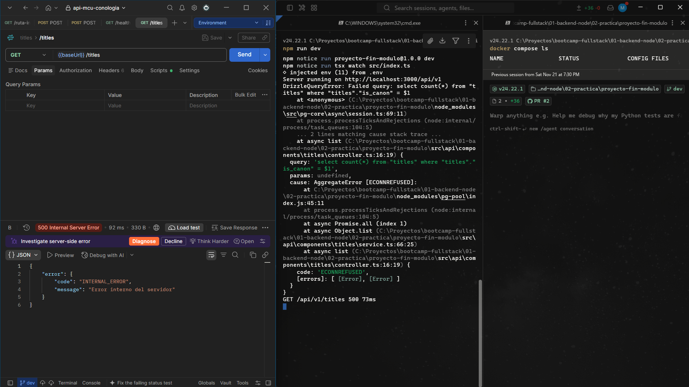

# API REST · Cronología del Universo Cinematográfico de Marvel

API REST para consultar la **línea temporal del UCM** (películas, series, especiales y sus escenas post-créditos) y llevar el **seguimiento personal** de lo que cada usuario va viendo.

- La entidad del CRUD de la consigna es **`titles`** (obras): cualquiera puede consultarlas; solo el **admin** crea, edita y borra.
- Cada usuario registrado marca ítems como `watched` o `skipped` en `/me/progress` y solo ve **lo suyo**.
- Datos reales: el seed carga las obras, episodios, ediciones, tags y la cronología desde los CSV de `docs/csv/`.

**Contenido de este README:** [1. Stack](#1-stack) · [2. Instalación](#2-instalación-paso-a-paso) · [3. Estructura](#3-estructura-del-proyecto) · [4. Autenticación](#4-autenticación) · [5. Endpoints](#5-endpoints) · [6. Respuestas y códigos](#6-formato-de-respuesta-y-códigos-de-estado) · [7. Reglas de negocio](#7-reglas-de-negocio) · [8. Extras](#8-extras-implementados) · [9. Pruebas con Thunder Client](#9-pruebas-con-thunder-client)

---

## 1. Stack

| Pieza | Uso |
| --- | --- |
| Node.js + TypeScript | Runtime y lenguaje (ESM, `tsx` para desarrollo) |
| Express 5 | Servidor HTTP y routing |
| PostgreSQL 16 (Docker) | Base de datos |
| Drizzle ORM + drizzle-kit | Schema, migraciones y queries |
| Zod 4 | Validación de params, query y body |
| bcrypt | Hash de contraseñas |
| jsonwebtoken | Autenticación con JWT |

---

## 2. Instalación paso a paso

**Requisitos:** [Node.js](https://nodejs.org) (probado con v24), [Git](https://git-scm.com) y [Docker](https://www.docker.com/products/docker-desktop) (la base de datos corre en un contenedor, no hace falta instalar PostgreSQL).

**1. Clonar el repositorio e instalar dependencias**

```bash
git clone https://github.com/MatiasSolisSchneeberger/proyecto-fin-modulo.git
cd proyecto-fin-modulo
npm install
```

**2. Crear el archivo `.env`** a partir de la plantilla y completarlo (valores de ejemplo en la sección siguiente). Hay que hacerlo **antes** de levantar Docker, porque `docker-compose.yml` lee las credenciales de ese archivo.

```bash
cp .env.example .env
```

En PowerShell: `Copy-Item .env.example .env`.

**3. Levantar la base de datos** (PostgreSQL en Docker):

```bash
docker compose up -d
```

**4. Crear las tablas** (aplica las migraciones de `drizzle/`):

```bash
npm run db:migrate
```

**5. Cargar los datos** (catálogo, cronología completa y el usuario admin):

```bash
npm run db:seed
```

**6. Levantar la API:**

```bash
npm run dev
```

Verificar que funciona: abrir <http://localhost:3000/api/v1/health>. Debe responder `{ "data": { "status": "ok", "db": "ok", ... } }`.

> ⚠️ `npm run db:seed` **vacía** las tablas del catálogo (y, en cascada, el progreso de los usuarios) antes de cargar: se puede correr las veces que haga falta para volver al estado inicial, pero borra las obras creadas a mano. Los usuarios **no** se borran y el admin no se duplica.

### Variables de entorno (`.env`)

Ejemplo de un `.env` completo para desarrollo (todos los valores son de ejemplo: cambiá las contraseñas):

```env
DB_USER=marvel
DB_PASSWORD=una-clave-para-la-base
DB_HOST=localhost
DB_PORT=5432
DB_NAME=mcu

DATABASE_URL=postgresql://${DB_USER}:${DB_PASSWORD}@${DB_HOST}:${DB_PORT}/${DB_NAME}

JWT_SECRET=pegar-aca-un-secreto-largo-y-aleatorio
JWT_EXPIRES_IN=1h

ADMIN_USERNAME=admin
ADMIN_EMAIL=admin@example.com
ADMIN_PASSWORD=una-clave-de-admin-8-o-mas
```

Para generar un `JWT_SECRET` aleatorio:

```bash
node -e "console.log(require('crypto').randomBytes(32).toString('hex'))"
```


| Variable | Para qué sirve |
| --- | --- |
| `DB_USER`, `DB_PASSWORD`, `DB_NAME` | Credenciales y nombre de la base. Las usa `docker-compose.yml` para crear el contenedor |
| `DB_HOST`, `DB_PORT` | Dónde corre Postgres (`localhost` y el puerto que publiques, ej. `5432`) |
| `DATABASE_URL` | Cadena de conexión. Ya viene armada con las variables anteriores (`${DB_USER}`…): no hace falta tocarla |
| `JWT_SECRET` | Secreto para firmar los tokens. **Mínimo 16 caracteres**; usá uno largo y aleatorio |
| `JWT_EXPIRES_IN` | Duración del token (ej. `1h`). Si no se define, `1h` |
| `ADMIN_USERNAME`, `ADMIN_EMAIL`, `ADMIN_PASSWORD` | Datos del admin que crea el seed (`ADMIN_PASSWORD`: 8 a 72 caracteres). La API arranca aunque estén vacías, pero no habrá admin |
| `PORT` | Puerto de la API (opcional, default `3000`) |

El `.env` **no se versiona** (está en `.gitignore`): en el repositorio solo está `.env.example`, con los nombres de las variables y sin valores.

### Problemas frecuentes

| Síntoma | Causa y solución |
| --- | --- |
| `Variables de entorno inválidas` al arrancar | Falta o es inválida alguna variable del `.env` (por ejemplo `JWT_SECRET` de menos de 16 caracteres). El mensaje indica cuál |
| `ECONNREFUSED` o `/health` responde 503 | La base no está levantada: `docker compose up -d` y revisar `DB_HOST`/`DB_PORT` |
| `npm run db:seed` avisa "Faltan ADMIN_*" | Completar `ADMIN_USERNAME`, `ADMIN_EMAIL` y `ADMIN_PASSWORD` y volver a correr el seed |
| El puerto 3000 o 5432 está ocupado | Cambiar `PORT` / `DB_PORT` en el `.env` (y reiniciar Docker si cambia `DB_PORT`) |

---

## 3. Estructura del proyecto

```
.
├── src/                  # código de la API (detalle abajo)
├── drizzle/              # migraciones SQL generadas por drizzle-kit
├── docs/                 # consigna, especificación, modelo de datos y CSV del seed (ver docs/README.md)
├── thunder-client/       # colecciones y environment de pruebas (ver sección 9)
├── postman/              # colección original en Postman (anterior a la migración a Thunder Client)
├── docker-compose.yml    # PostgreSQL 16
├── .env.example          # plantilla de variables de entorno
└── package.json
```

Dentro de `src/`:

```
src/
├── app.ts                  # arma la app: logger → JSON → rutas → 404 → errores
├── index.ts                # arranca el servidor
├── config/                 # carga y valida las variables de entorno (Zod)
├── db/
│   ├── schema/             # tablas y enums de Drizzle
│   ├── seeders/            # carga de datos desde docs/csv
│   └── seed.ts
└── api/
    ├── routers/index.ts    # monta cada componente bajo /api/v1
    ├── middleware/         # logger, requireAuth/requireRole, 404, error handler
    ├── errors/app-error.ts # clases de error con status y código
    └── components/<recurso>/
        ├── routes.ts       # URL → controller (+ middlewares de auth)
        ├── controller.ts   # HTTP ↔ service: valida con Zod y arma la respuesta
        ├── service.ts      # reglas de negocio y errores
        ├── repository.ts   # única capa que habla con la base (Drizzle)
        └── schema.ts       # validaciones Zod
```

Componentes: `health`, `auth`, `titles`, `universes`, `studios`, `platforms`, `tag-categories`, `tags`, `progress`.

**Capas** (una request las atraviesa en este orden): `routes` → `controller` → `service` → `repository`. Cada capa solo conoce a la siguiente: el controller no toca la base y el repository no sabe nada de HTTP.

---

## 4. Autenticación

1. **Registrarse:** `POST /api/v1/auth/register` con `{ "username", "email", "password" }` → crea un usuario con rol `user`.
2. **Loguearse:** `POST /api/v1/auth/login` con `{ "email", "password" }` → devuelve `{ "data": { "token": "..." } }`.
3. **Usar el token** en las rutas protegidas:

   ```
   Authorization: Bearer <token>
   ```

- La contraseña se guarda con **bcrypt** y **nunca** aparece en ninguna respuesta.
- El token (JWT) lleva solo `sub` (id del usuario) y `role` (`user` | `admin`). Expira según `JWT_EXPIRES_IN`.
- Login con email inexistente o clave incorrecta responde lo mismo (`INVALID_CREDENTIALS`), para no revelar cuál falló.
- **Admin:** no se puede crear por la API (el registro siempre da `user`). Lo crea `npm run db:seed` con los `ADMIN_*` del `.env`.

---

## 5. Endpoints

Base: `http://localhost:3000/api/v1`. 🔓 = público · 🔑 = requiere token · 👑 = requiere token de admin.

### Salud y autenticación

| Método | Ruta | Acceso | Body / query | Respuestas |
| --- | --- | :-: | --- | --- |
| GET | `/health` | 🔓 | – | 200, 503 `DB_UNAVAILABLE` |
| POST | `/auth/register` | 🔓 | body: `username` (3–50), `email`, `password` (8–72) | 201, 400, 409 `EMAIL_TAKEN` / `USERNAME_TAKEN` |
| POST | `/auth/login` | 🔓 | body: `email`, `password` | 200 `{ token }`, 400, 401 `INVALID_CREDENTIALS` |

### Obras (`titles`): el CRUD

| Método | Ruta | Acceso | Body / query | Respuestas |
| --- | --- | :-: | --- | --- |
| GET | `/titles` | 🔓 | query: `q`, `kind`, `releasedFrom`, `releasedTo`, `includeNonCanon`, `sort`, `page`, `limit` | 200 `{ data, meta }`, 400 |
| GET | `/titles/:id` | 🔓 | – | 200, 400, 404 `TITLE_NOT_FOUND` |
| POST | `/titles` | 👑 | body: `kind`, `title`, `releaseDate` (YYYY-MM-DD), `slug?`, `posterUrl?`, `synopsis?`, `isCanon?` | 201, 400, 401, 403, 409 `TITLE_SLUG_TAKEN` |
| PUT | `/titles/:id` | 👑 | body: cualquier campo de arriba (al menos uno) | 200, 400, 401, 403, 404, 409 |
| DELETE | `/titles/:id` | 👑 | – | 204, 400, 401, 403, 404 |

Query de `GET /titles`:

| Parámetro | Valores | Default |
| --- | --- | --- |
| `q` | texto a buscar en el título (1–100) | – |
| `kind` | `movie`, `series`, `short`, `special` | – |
| `releasedFrom`, `releasedTo` | fecha `YYYY-MM-DD` | – |
| `includeNonCanon` | `true` / `false` | `false` (se ocultan las obras no canon) |
| `sort` | `title`, `releaseDate`, `createdAt` (con `-` adelante = descendente) | `releaseDate` |
| `page`, `limit` | entero ≥ 1 / 1 a 100 | `1` / `20` |

### Progreso del usuario (`/me/progress`): todas 🔑

Cada usuario solo ve y modifica **su** progreso: el usuario sale siempre del token, nunca de la URL ni del body.

| Método | Ruta | Body / query | Respuestas |
| --- | --- | --- | --- |
| GET | `/me/progress` | query: `status` (`watched` \| `skipped`), `page`, `limit` | 200 `{ data, meta }`, 400, 401 |
| PUT | `/me/progress/:itemId` | body opcional: `status` (default `watched`), `watchedAt` (ISO 8601 con zona, default ahora) | 200, 400, 401, 404 `ITEM_NOT_FOUND` |
| DELETE | `/me/progress/:itemId` | – | 204 (también si no estaba marcado), 400, 401, 404 `ITEM_NOT_FOUND` |

Cada elemento de la respuesta incluye el ítem con su obra, y el episodio o la edición cuando corresponde:

```json
{
  "itemId": 87,
  "status": "watched",
  "watchedAt": "2026-11-21T20:00:00.000Z",
  "item": {
    "id": 87,
    "label": null,
    "segment": "episode",
    "durationMinutes": 52,
    "title": { "id": 12, "title": "Loki", "slug": "loki" },
    "episode": { "seasonNumber": 1, "episodeNumber": 3, "title": "Lamentis" },
    "edition": null
  }
}
```

`segment` distingue las partes de una misma obra (`full`, `main`, `post_credits`, `bonus`, `episode`): marcar el cuerpo principal de una película **no** marca su escena post-créditos, son ítems separados.

### Catálogos (solo lectura, 🔓)

| Método | Ruta | Query | Respuestas |
| --- | --- | --- | --- |
| GET | `/universes` | `q` | 200 |
| GET | `/universes/:code` | – | 200, 404 `UNIVERSE_NOT_FOUND` |
| GET | `/studios` | `q` | 200 |
| GET | `/studios/:id` | – | 200, 400, 404 `STUDIO_NOT_FOUND` |
| GET | `/platforms` | `q` | 200 |
| GET | `/platforms/:id` | – | 200, 400, 404 `PLATFORM_NOT_FOUND` |
| GET | `/tag-categories` | – | 200 |
| GET | `/tags` | `q`, `categoryId` | 200, 400 |
| GET | `/tags/:slug` | – | 200, 404 `TAG_NOT_FOUND` |

---

## 6. Formato de respuesta y códigos de estado

**Éxito:** `{ "data": ... }`, o `{ "data": [...], "meta": { "page", "limit", "total", "totalPages" } }` en listados paginados. `204` no lleva body.

**Error:** siempre la misma forma.

```json
{
  "error": {
    "code": "VALIDATION_ERROR",
    "message": "Hay errores de validación",
    "details": [{ "field": "releaseDate", "message": "Formato esperado: YYYY-MM-DD" }]
  }
}
```

`details` solo aparece en errores de validación.

| Código | Cuándo | `error.code` típico |
| --- | --- | --- |
| 200 | Consulta o actualización correcta | – |
| 201 | Recurso creado | – |
| 204 | Borrado correcto, sin body | – |
| 400 | Params, query o body inválidos; JSON mal formado; regla de negocio | `VALIDATION_ERROR`, `INVALID_JSON`, `INVALID_RELEASE_DATE`, `INVALID_WATCHED_AT` |
| 401 | Falta el token, es inválido o expiró; credenciales incorrectas | `MISSING_TOKEN`, `INVALID_TOKEN`, `INVALID_CREDENTIALS` |
| 403 | Token válido pero sin el rol necesario (usuario común en una ruta de admin) | `FORBIDDEN` |
| 404 | El recurso o la ruta no existen | `TITLE_NOT_FOUND`, `ITEM_NOT_FOUND`, `ROUTE_NOT_FOUND`… |
| 409 | Conflicto con datos existentes | `TITLE_SLUG_TAKEN`, `EMAIL_TAKEN`, `USERNAME_TAKEN` |
| 500 | Error inesperado. El detalle va al log del servidor, **nunca** a la respuesta | `INTERNAL_ERROR` |
| 503 | La base de datos no responde (solo `/health`) | `DB_UNAVAILABLE` |

---

## 7. Reglas de negocio

- **Fecha de estreno** (`releaseDate`): entre `1900-01-01` y hoy + 10 años (`INVALID_RELEASE_DATE`).
- **Slug único:** si no se envía, se genera desde el título (`"Iron Man 3!"` → `iron-man-3`). Repetido → 409 `TITLE_SLUG_TAKEN`.
- **Obras no canon:** se ocultan por defecto; se muestran con `includeNonCanon=true`.
- **Progreso:** el ítem tiene que existir (`ITEM_NOT_FOUND`) y `watchedAt` no puede estar en el futuro (`INVALID_WATCHED_AT`). Un ítem sin fila de progreso se considera pendiente.
- **Permisos:** solo el admin escribe en el catálogo; cada usuario solo escribe y lee su propio progreso.
- **Email y username únicos** (el email sin distinguir mayúsculas).

---

## 8. Extras implementados

**Filtros y ordenamiento** (`/titles`):

```
GET /api/v1/titles?q=iron&kind=movie&releasedFrom=2008-01-01&sort=-releaseDate&page=1&limit=10
```

**Roles** (`user` / `admin`): un usuario común que intenta crear una obra recibe 403.

```
POST /api/v1/titles        Authorization: Bearer <token de user>   →  403 FORBIDDEN
POST /api/v1/titles        Authorization: Bearer <token de admin>  →  201
```

**Logging:** cada request se imprime en la consola del servidor con método, URL, status y duración.

```
GET /api/v1/titles?kind=movie 200 12ms
POST /api/v1/titles 401 2ms
```

**Relación entre modelos:** `users` ↔ `timeline_items` mediante `user_watch_progress` (PK `userId + itemId`). `GET /me/progress` devuelve solo los ítems del usuario del token, con su obra, episodio y edición.

---

## 9. Pruebas con Thunder Client

Las pruebas están en la carpeta [`thunder-client/`](thunder-client/), listas para importar en la extensión **Thunder Client** de VS Code. Son **87 requests**, casi todas con su test de status (`res-code`):

| Archivo | Contenido |
| --- | --- |
| `thunder-collection_API MCU Cronologia.json` | Colección **1/2** (47 requests): `auth` (admin y user), `health`, `me-progress`, `misc`, `platforms`, `studios`, `tag-categories` |
| `thunder-collection_API MCU Cronologia - parte 2.json` | Colección **2/2** (40 requests): `titles` (el CRUD), `tags`, `universes` |
| `thunder-environment_env.json` | Environment `env` con las variables (`baseUrl`, credenciales, tokens) |

> Son dos colecciones porque el plan gratuito de Thunder Client limita cada colección a 50 requests.

### Cómo correrlas

1. Tener la API levantada y con datos (sección 2: `npm run db:seed` y `npm run dev`).
2. En Thunder Client: **Collections → ⋯ → Import** y elegir las **dos** colecciones. En **Env → ⋯ → Import**, el archivo del environment, y dejar `env` como activo.
3. Completar en el environment `env` (los tokens se llenan solos):

   | Variable | Qué poner |
   | --- | --- |
   | `baseUrl` | `http://localhost:3000/api/v1` (ya viene) |
   | `userName`, `userEmail`, `userPassword` | Datos de un usuario de prueba nuevo (ej. `tester`, `tester@example.com`, una clave de 8+ caracteres) |
   | `adminEmail`, `adminPassword` | Los mismos valores de `ADMIN_EMAIL` y `ADMIN_PASSWORD` de tu `.env` |
   | `token`, `adminToken`, `createdTitleId` | **No tocar**: los guardan los propios requests |

4. Ejecutar **en este orden** (en la colección 1/2):
   1. `auth / user` → `POST /auth/register (201)`: crea el usuario de prueba.
   2. `auth / user` → `POST /auth/login (200)`: guarda `{{token}}`.
   3. `auth / admin` → `POST /auth/login admin (200)`: guarda `{{adminToken}}`.
5. Desde ahí se puede correr cualquier carpeta con **Run all** (o request por request). Las requests de escritura de `titles` usan `{{adminToken}}`; `/me/progress` usa `{{token}}`. En la colección 2/2, `POST /titles (201, admin)` guarda `{{createdTitleId}}`, que después usan el `PUT` y el `DELETE`.

Si se repite la corrida con el mismo usuario, `POST /auth/register (201)` devuelve 409 (el usuario ya existe): es esperado; para que vuelva a dar 201, cambiá `userEmail` y `userName`.

### Qué cubren

Para cada endpoint del CRUD de `titles` y de `/me/progress`, el caso feliz y los errores:

| Código | Casos probados |
| --- | --- |
| **200 / 201 / 204** | Listados con cada filtro, detalle, alta, edición, borrado, progreso |
| **400** | Query inválida (`limit=500`, fecha mal formada, `sort` fuera de la lista), id no numérico o negativo, body inválido o vacío, `status` y `watchedAt` inválidos |
| **401** | Sin token, token inválido, header sin `Bearer`, login con clave incorrecta |
| **403** | Usuario común intentando crear, editar o borrar una obra |
| **404** | Obra, ítem, plataforma, estudio o tag inexistente; ruta inexistente |
| **409** | Slug de obra repetido, email ya registrado |

### El error 500

No se puede provocar con una request, así que se probó apagando la base de datos (`docker stop mcu-chronological-order`) y llamando a `GET /titles`. La API responde `500 INTERNAL_ERROR` con un mensaje genérico, **sin stack trace ni SQL**; el detalle queda solo en la consola del servidor (a la derecha de la captura):



Para volver a la normalidad: `docker start mcu-chronological-order`.

> La carpeta [`postman/`](postman/) conserva la colección original en Postman, anterior a la migración a Thunder Client. No hace falta para probar la API.
